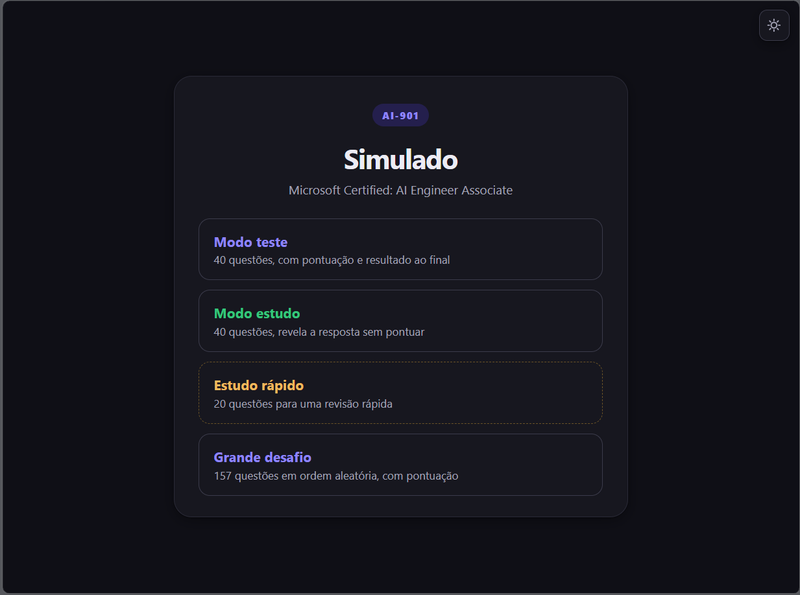
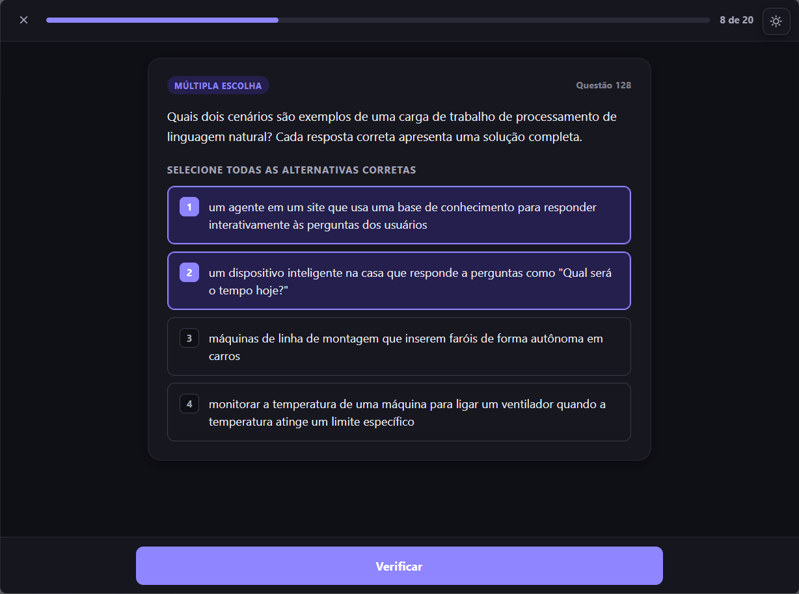
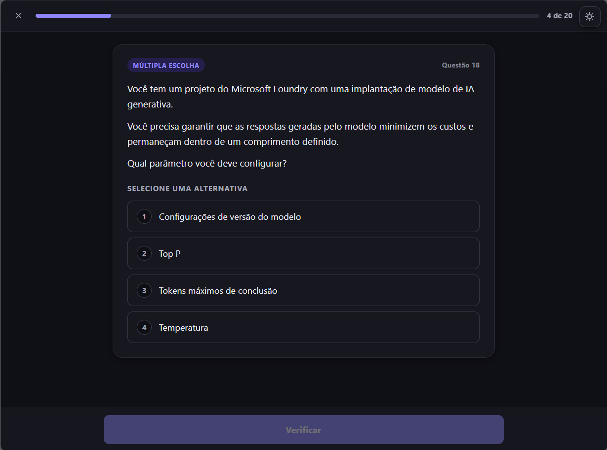
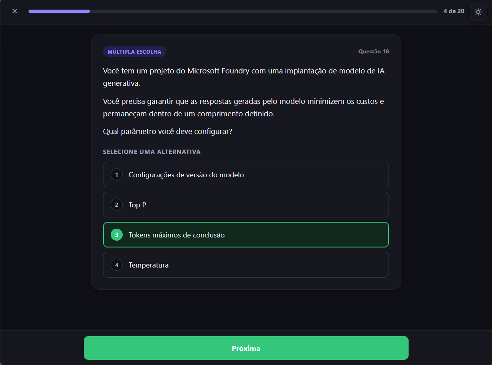
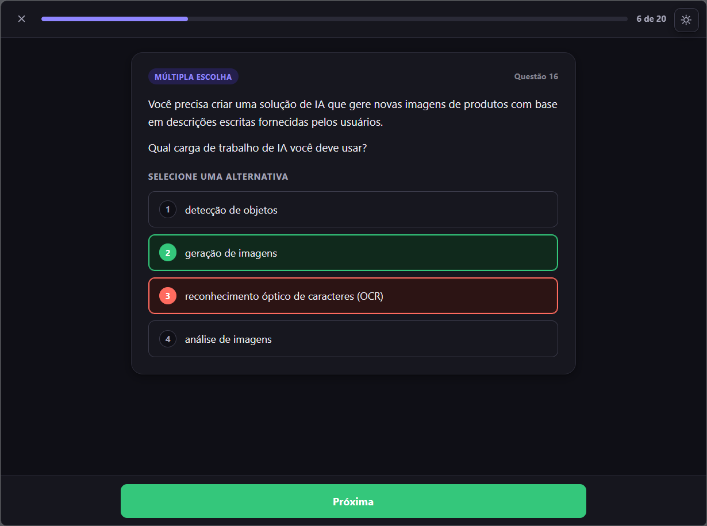
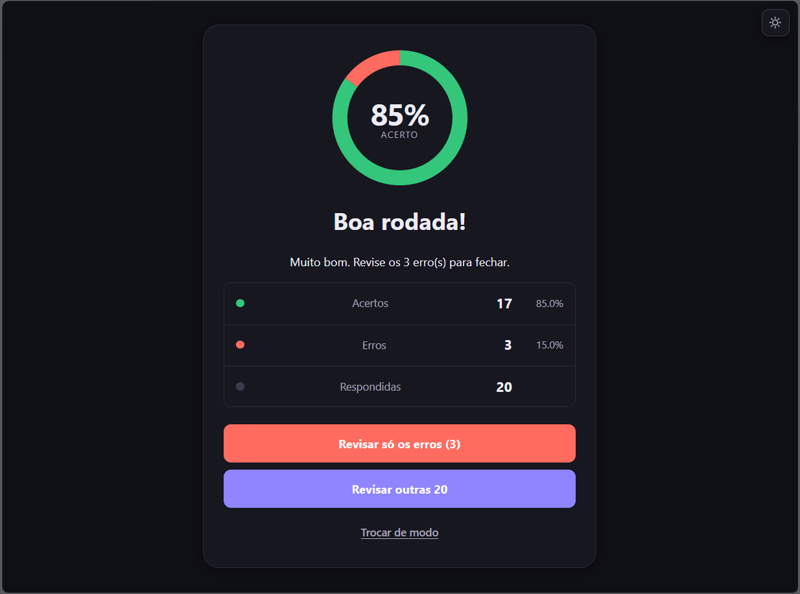

# AI-901 · Simulado

Simulado de estudos para o exame **Microsoft Certified: AI Engineer Associate (AI-901)**, com o acervo completo de questões do exame, gabarito conferido e quatro modos de prática — do simulado cronometrado com pontuação à revisão livre de erros.

É um site estático: **sem build, sem dependências, sem servidor, sem internet**. Abra o `index.html` e ele funciona.

## Para quem é

Quem está se preparando para o AI-901 e quer treinar contra as questões reais do exame em vez de listas genéricas de Multiple Choice. Serve tanto para quem quer medir o próprio desempenho (modo teste) quanto para quem quer apenas revisar o conteúdo no próprio ritmo (modo estudo).

## Modos de prática

A tela inicial oferece quatro modos. Teste e grande desafio pontuam e terminam na tela de resultado; estudo e estudo rápido apenas revelam a resposta correta, sem somar nada.

| Modo | Tamanho da rodada | Pontuação | Para quê |
| --- | --- | --- | --- |
| **Modo teste** | 40 questões | sim | simular o exame e medir o desempenho |
| **Modo estudo** | 40 questões | não | revisar o conteúdo no ritmo que quiser, com a resposta revelada |
| **Estudo rápido** | 20 questões | não | uma passada curta de revisão quando o tempo é pouco |
| **Grande desafio** | o acervo inteiro (157 questões) | sim | cobrir tudo, em ordem sorteada, com nota no final |

Em todos os modos a ordem das questões é sorteada a cada rodada. A banca mistura formatos, e o app reproduz os quatro que aparecem no exame:

- **Múltipla escolha** (74) — escolha de uma ou mais alternativas.
- **Drop-down** (39) — preencher lacunas com opções de menu.
- **Hotspot** (36) — marcar as áreas corretas de uma imagem.
- **Drag and drop** (8) — arrastar valores para os destinos certos.

Além do gabarito, cada questão mostra o enunciado e as alternativas **exatamente como estão no material do exame**: nada é reescrito, traduzido por resumo ou adaptado. As alternativas são renumeradas na ordem em que aparecem, e a marcação de "correta" acompanha a alternativa, de modo que o número exibido nunca fica desconectado do texto. Há também revisão de erros ao final das rodadas pontuadas, tema claro/escuro com alternância e navegação acessível por teclado e leitor de tela.

## Como executar

### Abrir o arquivo direto

Clique duas vezes em `index.html`, ou abra-o no navegador. Funciona em `file://`, offline, sem nenhum servidor — é a forma como o app foi feito para rodar.

## Estrutura de arquivos

```
.
├── index.html    # markup das telas (início, rodada, resultado) e os botões de modo
├── styles.css    # estilos, incluindo tema claro/escuro via data-tema
├── script.js     # toda a lógica: sorteio, modos, verificação, pontuação, tema
├── dados.js      # o acervo: enunciados, alternativas e gabarito já resolvidos
└── README.md     # este documento
```

`index.html` carrega `styles.css`, `dados.js` e `script.js` como arquivos vizinhos, nessa ordem. Não existe `package.json`, dependência, CDN, fonte remota ou chamada de rede: **o app funciona com a internet desligada**. Os dados entram por `dados.js`, que apenas publica `window.QUIZ_DATA`; `script.js` lê essa variável e não faz parsing de nada em tempo de execução.

## Contribuindo com correções

Se você achou um gabarito errado, uma alternativa mal transcrita ou um enunciado com erro de digitação, esse é o tipo de contribuição mais útil aqui. Abra uma issue descrevendo a questão (número), o que está errado e qual é a resposta correta segundo a fonte do exame. Correções de conteúdo entram no workspace interno, são conferidas contra a fonte e chegam aqui pela reexportação descrita abaixo — não por edição direta deste repositório.

Pull requests de código também são bem-vindos, com uma ressalva: **este pacote é cópia** (veja a seção seguinte). Mudança no app precisa ser feita na origem e reexportada, não só aqui.

## Licença

Material de estudo derivado de conteúdo público de certificação da Microsoft. O código deste repositório está sob a licença **MIT**: uso, cópia, estudo, modificação e redistribuição são livres, com a única obrigação de preservar o aviso de copyright e o texto da licença. O conteúdo das questões do exame pertence à Microsoft e é usado aqui para fins de estudo; a marca Microsoft Certified e o nome AI-901 são de seus respectivos proprietários.

## Acessibilidade

O app foi construído para funcionar bem com teclado e leitor de tela: os acertos e erros são anunciados por uma região `aria-live`, os botões têm rótulos acessíveis e o estado do tema é exposto por `aria-pressed`. Se você encontrar algum problema de acessibilidade, isso também é uma issue bem-vinda.

## Resultados











